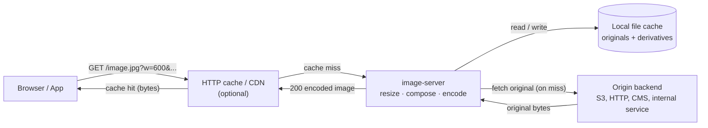

# An opinionated image server written in Go

A reverse proxy that resizes images to a specific size, can automatically crop
away excess whitespace, and has a few other features. This project follows the
[RESTful Image API Specification](https://github.com/riapi/riapi) with some
additions and was primarily written for content management systems where
images uploaded by less technical users should be easily corrected and output
in different sizes as needed.

## How image delivery works

The `image-server` process receives signed image URLs, fetches the untouched
original from the configured origin, applies the requested transformation and
encodes the result. Both the fetched original and the final derivative are
stored on the local filesystem so repeated requests for the same transformation
are answered from disk without touching the origin.

### Caching layers

- **In front of the image server:** any HTTP cache can be placed between
  clients and the server because responses are plain, cacheable HTTP with
  `Cache-Control` and `Vary` set appropriately. Typical choices are
  [Varnish](https://varnish-cache.org/), [nginx](https://nginx.org/) as a
  caching reverse proxy, [Apache Traffic Server](https://trafficserver.apache.org/),
  or managed CDNs such as Cloudflare, Fastly, AWS CloudFront, Akamai or Bunny.
  A reverse proxy is strongly recommended for public traffic so that most
  requests never reach the Go process.
- **Inside the image server:** derivatives (and fetched originals) are
  persisted to `imageCacheDir` on the local filesystem. The cache key covers
  the request path, profile, dimensions, output format and encoder settings,
  so changing any of them produces a new entry without invalidating the
  previous one. Point `imageCacheDir` at a local SSD, a shared network volume
  (NFS/CIFS) or a Docker volume — anything that behaves like a POSIX
  filesystem works.
- **Origin backends:** anything that serves the untouched original over HTTP(S)
  by path is a valid origin — object storage such as S3, MinIO or Backblaze
  B2, another nginx/CDN that fronts your assets, a CMS or an internal
  microservice. Origin query parameters are not supported; the request path is
  appended to `[server].originalBackend`.

## Documentation

- [Getting started](doc/getting-started.md) — build, configure and run the
  server locally or in Docker.
- [URL parameters](doc/url-parameters.md) — the full list of transformation
  parameters, with an example request.
- [Request signing](doc/signing.md) — how to generate the `hash` value and
  configure the signing algorithm.
- [Image compositions](doc/compositions.md) — the `put` / `putb` / `canvas`
  parameters for layered compositions on top of a background or blank canvas.
- [Output formats and encoder defaults](doc/output-formats.md) — AVIF/WebP/JPEG
  negotiation and encoder tuning.
- [CORS](doc/cors.md) — enable browser cross-origin requests to the image
  server.
- [Limits and quotas](doc/limits.md) — origin fetch, image processing and
  HTTP request limits.

Sample configuration lives in [`config.sample.toml`](config.sample.toml);
ready-to-use composition examples are in [`doc/examples`](doc/examples).
